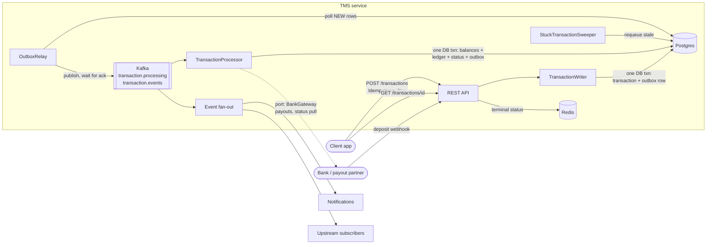
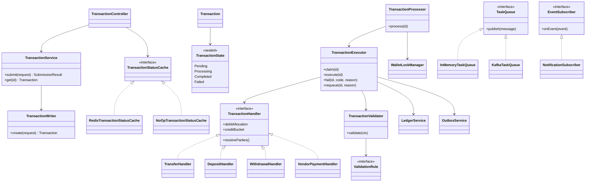
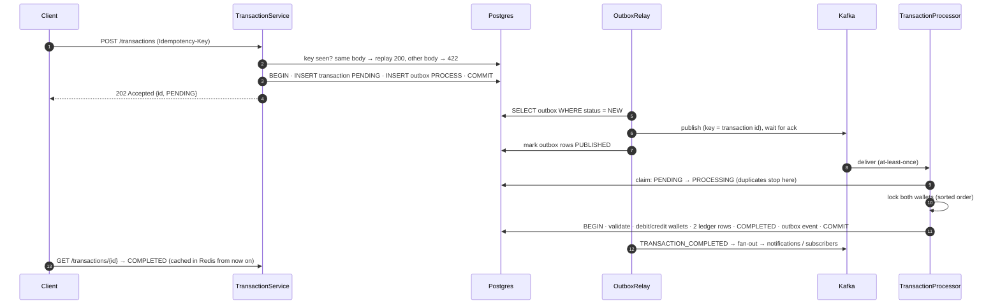
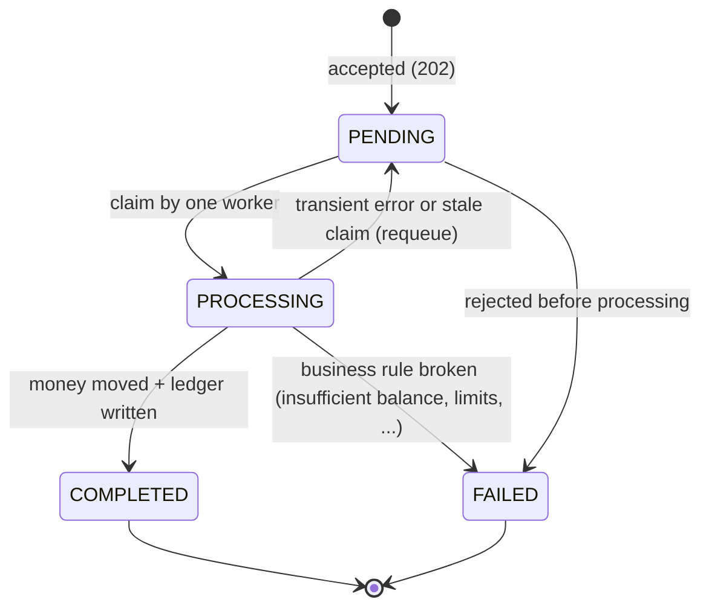

# TMS: Wallet Transaction Management Service

[](https://github.com/viren97/wallet-ledger-service/actions/workflows/ci.yml)

A wallet-based money-movement service: transfers, deposits, withdrawals and vendor payments, processed
asynchronously with a state-machine lifecycle, a double-entry ledger, the transactional outbox,
idempotent APIs and recovery from crashes. Runs on SQLite with zero setup, or on Postgres + Kafka + Redis
with one `docker compose` command.

**Stack:** Kotlin 2.0 · Spring Boot 3.5 · Spring Data JPA · Postgres (SQLite for local dev) · Kafka · Redis ·
Docker Compose · Helm · Java 17

## Engineering highlights

> **For reviewers:** each row points to the code and the test that proves it. The reasoning behind the main
> decisions is in the [architecture decision records](docs/adr/).

| Skill | What I built | Proof |
|---|---|---|
| **Financial correctness** | Double-entry ledger written in the same DB transaction as every balance change; money in `Long` minor units; a reconciliation endpoint re-derives balances from the ledger | [`LedgerService`](src/main/kotlin/dev/viren/tms/ledger/LedgerService.kt) · [`TransactionExecutor`](src/main/kotlin/dev/viren/tms/transaction/service/TransactionExecutor.kt) · [ADR-001](docs/adr/001-double-entry-ledger.md) |
| **Concurrency control** | Striped wallet locks taken in sorted order (no deadlocks) plus `@Version` optimistic locking across instances; 200 concurrent opposite transfers keep balances exact and the ledger at zero | [`WalletLockManager`](src/main/kotlin/dev/viren/tms/wallet/WalletLockManager.kt) · test `concurrent opposite transfers keep balances and ledger consistent` · [ADR-003](docs/adr/003-striped-locks-and-optimistic-locking.md) |
| **Distributed-systems reliability** | Transactional outbox: the state change and the next step commit atomically; the relay marks a row published only after the broker acks; consumers are idempotent | [`OutboxService`](src/main/kotlin/dev/viren/tms/outbox/OutboxService.kt) · [`OutboxRelay`](src/main/kotlin/dev/viren/tms/outbox/OutboxRelay.kt) · [ADR-002](docs/adr/002-async-processing-with-outbox.md) |
| **Idempotent APIs** | `Idempotency-Key` with request fingerprinting (replay → 200, misuse → 422) that survives a concurrent duplicate at commit; bank webhooks are idempotent on the bank reference | [`TransactionService`](src/main/kotlin/dev/viren/tms/transaction/service/TransactionService.kt) · [`BankWebhookController`](src/main/kotlin/dev/viren/tms/transaction/api/BankWebhookController.kt) · test `same idempotency key replays, different payload is rejected` |
| **Crash recovery** | Sweeper re-queues stranded transactions; a slow worker and the requeue can't both commit; poison transactions fail after N attempts | [`StuckTransactionSweeper`](src/main/kotlin/dev/viren/tms/transaction/recovery/StuckTransactionSweeper.kt) · test `sweeper recovers a transaction stranded in PROCESSING and applies it exactly once` |
| **Domain modelling** | Sealed-class state machine (illegal transitions throw); wallet invariants inside the entity (user wallets can't go negative, system wallets can) | [`TransactionState`](src/main/kotlin/dev/viren/tms/transaction/state/TransactionState.kt) · [`Wallet`](src/main/kotlin/dev/viren/tms/wallet/Wallet.kt) · [`TransactionStateTest`](src/test/kotlin/dev/viren/tms/transaction/TransactionStateTest.kt) · [`WalletTest`](src/test/kotlin/dev/viren/tms/wallet/WalletTest.kt) |
| **Extensible design** | A transaction type is one strategy bean declaring its parties and which balance bucket pays (promo-first vs withdrawable-only) | [`Handlers`](src/main/kotlin/dev/viren/tms/transaction/handler/Handlers.kt) · [`BalanceAllocationStrategy`](src/main/kotlin/dev/viren/tms/transaction/handler/BalanceAllocationStrategy.kt) · [`BalanceAllocationTest`](src/test/kotlin/dev/viren/tms/transaction/BalanceAllocationTest.kt) |
| **Config-driven business rules** | The validation chain is defined in YAML: rules per transaction type with merged params, cheap rules first, and a bad config fails at startup | [`TransactionValidator`](src/main/kotlin/dev/viren/tms/transaction/validation/TransactionValidator.kt) · [`Rules`](src/main/kotlin/dev/viren/tms/transaction/validation/rules/Rules.kt) · [`TransactionValidatorTest`](src/test/kotlin/dev/viren/tms/transaction/TransactionValidatorTest.kt) · [ADR-004](docs/adr/004-config-driven-validation-chain.md) |
| **Read scalability** | The Redis cache holds only terminal statuses: nothing to invalidate, no stale reads, fails open | [`TransactionStatusCache`](src/main/kotlin/dev/viren/tms/transaction/api/TransactionStatusCache.kt) · [ADR-005](docs/adr/005-cache-only-terminal-statuses.md) |
| **Clean architecture** | Ports and adapters: in-memory ↔ Kafka queue, no-op ↔ Redis cache, bank gateway port, all swapped by config | [`TaskQueue`](src/main/kotlin/dev/viren/tms/queue/TaskQueue.kt) · [`KafkaTaskQueue`](src/main/kotlin/dev/viren/tms/queue/KafkaTaskQueue.kt) · [`BankGateway`](src/main/kotlin/dev/viren/tms/integration/bank/BankGateway.kt) |
| **Delivery & operations** | Multi-stage non-root Docker image, compose stack (Postgres, Kafka KRaft, Redis), Helm chart (HPA, probes, External Secrets), fail-fast secrets, CI | [`Dockerfile`](Dockerfile) · [`deploy/helm/tms`](deploy/helm/tms) · [CI](.github/workflows/ci.yml) · [docs/DEPLOYMENT.md](docs/DEPLOYMENT.md) |

**At a glance:** 49 production classes · 23 tests (18 unit, 5 end-to-end, including a 200-thread concurrency test) ·
runs with zero setup or as a full stack with `docker compose up`.

---

| | |
|---|---|
| [Engineering highlights](#engineering-highlights) · [Run it](#run-it) | [Architecture (HLD)](#architecture-hld) · [Low-level design](#low-level-design-lld) |
| [Request flow](#request-flow) | [State machine](#transaction-state-machine) · [Failure handling](#failure-handling) |
| [Design choices & trade-offs](#design-choices-and-trade-offs) | [API](docs/API.md) · [Partner integration](docs/PARTNER_INTEGRATION.md) · [Deployment, config & secrets](docs/DEPLOYMENT.md) · [Roadmap](docs/ROADMAP.md) |

---

## Run it

**Full stack (Postgres, Kafka, Redis, app)**
```bash
docker compose up --build          # API on http://localhost:8080, health on /actuator/health
```

**Infra in Docker, app from your IDE**
```bash
docker compose up -d postgres redis kafka
SPRING_PROFILES_ACTIVE=docker DB_URL=jdbc:postgresql://localhost:5432/tms DB_PASSWORD=tms-local-only \
  KAFKA_BOOTSTRAP_SERVERS=localhost:29092 REDIS_HOST=localhost ./gradlew bootRun
```

**No Docker at all** (SQLite file + in-memory queue, no cache)
```bash
./gradlew bootRun                  # creates ./tms.db
./gradlew test                     # unit + concurrent end-to-end tests
```

Try it: [docs/API.md](docs/API.md) has curl examples for every endpoint.

| Profile | Database | Queue | Status cache | Use |
|---|---|---|---|---|
| default | SQLite (1 connection) | in-memory | off | quick local runs, tests |
| `docker` | Postgres (pool 20) | Kafka | Redis | docker-compose, Kubernetes |

---

## Architecture (HLD)



- **Writes are accepted fast, processed async.** `POST` stores the transaction and an outbox row in one
  DB transaction and returns `202`. Money moves later, in a worker.
- **No dual-write problem.** Business data and the event that triggers the next step commit together (outbox);
  a relay publishes to Kafka after commit, and only marks the row published once the broker has acked.
- **Postgres is the source of truth.** Kafka carries work; Redis only caches terminal statuses.
- **Reads scale separately.** Status polls hit Redis for finished transactions; in-flight ones read the DB.

## Low-level design (LLD)



| Pattern | Where | Why |
|---|---|---|
| **State** | `transaction/state` | Each status allows only its own transitions; illegal moves throw instead of corrupting data |
| **Strategy + registry** | `transaction/handler` | A transaction type = one handler bean declaring parties and which balance bucket pays; money movement stays in one executor |
| **Chain of responsibility (config-driven)** | `transaction/validation` | Rules are beans; `application.yml` enables them and sets limits per type; bad config fails at boot |
| **Ports & adapters** | `queue/TaskQueue`, `integration/bank/BankGateway`, `TransactionStatusCache` | Swap in-memory ↔ Kafka, no-op ↔ Redis, mock ↔ real bank without touching business code |
| **Observer** | `event` | Terminal events fan out to every subscriber, each isolated from the others' failures |
| **Transactional outbox** | `outbox` | State change and "do the next step" commit atomically |

Project layout:
```
src/main/kotlin/dev/viren/tms
├── common/        error codes, exception advice, base entity (UUID ids + @Version)
├── user/          users
├── wallet/        wallets, balance buckets, system wallets, striped wallet locks
├── ledger/        double-entry ledger, reconciliation
├── transaction/   domain, state, handler (strategies), validation, service, api, recovery (sweeper)
├── outbox/        outbox entity, service, relay
├── queue/         TaskQueue port; in-memory and Kafka adapters
├── event/         transaction events + fan-out
├── notification/  channels + subscriber
└── integration/   BankGateway port (partner integration)
deploy/helm/tms    Helm chart (ConfigMap, ExternalSecret, Deployment, Service, HPA)
```

## Request flow



## Transaction state machine



`COMPLETED` and `FAILED` are final: every transition out of them is rejected.

## Failure handling

| What goes wrong | What happens | Why it's safe |
|---|---|---|
| Client retries `POST` (timeout, double tap) | Same key + same body returns the original transaction (200); different body → 422 | Unique `idempotency_key` + request hash |
| Same Kafka/queue message delivered twice | Second `claim()` sees status ≠ PENDING and skips | Status check + `@Version` on the row |
| Two transfers touch the same wallets | Striped locks taken in sorted order; `@Version` retry across instances | No deadlocks, no lost updates; 200-thread test proves balances and ledger stay consistent |
| Business rule fails (insufficient balance, limits, frozen wallet) | `FAILED` with `failureCode`, no money moved | Validation + balance changes are one DB transaction |
| Transient error (lock conflict outlasting retries, DB hiccup) | Rolled back, requeued to `PENDING`; failed only after `tms.processing.max-attempts` | Nothing committed, so retrying can't double-apply |
| Crash after claim, or queued message lost (restart, dead letter) | `StuckTransactionSweeper` requeues anything non-terminal untouched for 60s | A slow worker and the requeue can't both commit: the row's `@Version` lets only one through |
| Kafka down | Relay stops at the first failed publish and retries next tick; API still accepts writes | Outbox rows stay `NEW` until the broker acks |
| Redis down | Status reads fall through to Postgres | Cache fails open; it only holds immutable terminal states |
| Bank webhook replayed | Applied once | Bank reference is the idempotency key + unique `external_reference` |
| Ledger drifts from balances | `GET /wallets/{id}/reconciliation` re-derives balances from the ledger | Every movement writes DEBIT + CREDIT in the same transaction as the balance |

Partner payouts (timeouts that are *unknown* rather than failed, conflicting partner statuses, reconciliation)
are covered in [docs/PARTNER_INTEGRATION.md](docs/PARTNER_INTEGRATION.md).

## Design choices and trade-offs

| Decision | Chosen | Alternative | Trade-off |
|---|---|---|---|
| Accept then process async | `202` + outbox + worker | Process inside the request | Higher throughput and isolation from slow steps; clients must poll or subscribe for the result |
| Event publishing | Transactional outbox + relay | Publish to Kafka inside the request | No lost or phantom events; adds a relay and up to one poll interval of latency |
| Concurrency on wallets | In-JVM striped locks + `@Version` optimistic locking | `SELECT … FOR UPDATE` | Fast on one instance, correct across instances; a hot wallet still serialises (see roadmap: sub-wallets) |
| Balance check | Domain method on the loaded entity inside the locked transaction | Conditional `UPDATE … WHERE balance >= amount` | Keeps rules in the domain model (buckets, system wallets); a conditional update would be cheaper on very hot rows |
| Money type | `Long` minor units | `BigDecimal` / floats | Exact and fast; currency carried alongside |
| Balances | Stored balance + append-only double-entry ledger | Ledger only, balance computed on read | O(1) balance reads; ledger is the audit trail and reconciliation source |
| Failure classification | Business errors fail; everything else requeues with an attempt cap | Fail on any exception | Legit transfers survive transient errors; a poison transaction ends `FAILED` after N attempts |
| Recovery | Periodic sweeper over `(status, updated_at)` | Rely on the broker only | Covers crashes and lost messages for any queue; adds a background job and an index |
| Queue | `TaskQueue` port: in-memory by default, Kafka in `docker` | Kafka everywhere | Tests and local runs need no infra; Kafka gives durability and partition ordering by transaction id |
| Status cache | Redis, terminal states only | Cache everything with invalidation | No invalidation bugs, no stale reads; in-flight polls still hit the DB |
| Schema | Hibernate `ddl-auto: update` | Flyway migrations | Fast iteration for a demo; production should use Flyway (roadmap) |
| Local DB | SQLite, 1 connection | Postgres only | Zero-setup `./gradlew bootRun`; concurrency realism comes from the Postgres profile |

## Configuration and secrets

- Config is layered: `application.yml` (defaults) → `application-docker.yml` (profile) → environment variables.
- Every infra endpoint is an env var (`DB_URL`, `KAFKA_BOOTSTRAP_SERVERS`, `REDIS_HOST`, …).
- Secrets (`DB_PASSWORD`, `REDIS_PASSWORD`, partner keys) have **no defaults**, so a missing secret fails at startup.
- In Kubernetes the Helm chart reads them from Vault / AWS Secrets Manager through the External Secrets Operator;
  nothing secret lives in `values.yaml` or the image. Details: [docs/DEPLOYMENT.md](docs/DEPLOYMENT.md).
- Validation rules are config, not code:

```yaml
tms:
  validation:
    defaults:
      amount-limit: { params: { min: 100, max: 10000000 } }
      sufficient-balance: { enabled: true }
    overrides:
      WITHDRAWAL:
        amount-limit: { params: { min: 1000, max: 5000000 } }
      DEPOSIT:
        sufficient-balance: { enabled: false }
```
Effective rule chains are logged at startup and exposed at `GET /api/v1/admin/validation-rules`.

## Extending
- **New transaction type:** an enum value + a `TransactionHandler` bean.
- **New validation rule:** a `ValidationRule` bean + its key in `tms.validation`.
- **New subscriber / notification channel:** an `EventSubscriber` / `NotificationChannel` bean.
- **New payout partner:** a `BankGateway` adapter, see [docs/PARTNER_INTEGRATION.md](docs/PARTNER_INTEGRATION.md).

## Tests
- `TransactionStateTest`: allowed and illegal transitions, requeue.
- `WalletTest`: bucket invariants, system-wallet overdraft.
- `BalanceAllocationTest`: promo-first vs withdrawable-only.
- `TransactionValidatorTest`: config merge, per-type disabling, ordering, fail-fast on bad config.
- `TransactionFlowIntegrationTest` (full async path): 200 concurrent A↔B transfers keep balances correct and the
  ledger at zero; insufficient balance moves no money; idempotent replay; fan-out; a transaction stranded in
  `PROCESSING` is recovered by the sweeper and applied exactly once.

## Not built yet
Partner payout adapter, webhook HMAC verification, Flyway, auth, metrics: see [docs/ROADMAP.md](docs/ROADMAP.md).
