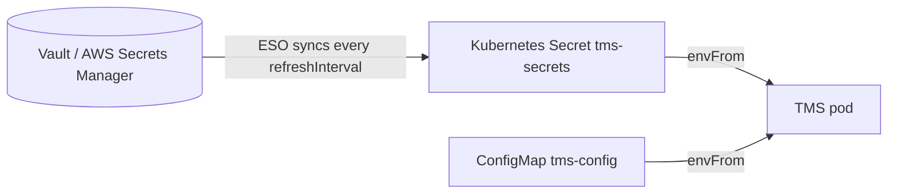

# Deployment, configuration and secrets

## Environments

| Where | How it runs | Config source | Secrets |
|---|---|---|---|
| Laptop, no Docker | `./gradlew bootRun` (SQLite, in-memory queue) | `application.yml` | none needed |
| Laptop, full stack | `docker compose up --build` | `application-docker.yml` + compose env | local-only defaults in `docker-compose.yml` |
| Kubernetes | Helm chart in `deploy/helm/tms` | ConfigMap from `values.yaml` | Vault / AWS Secrets Manager → External Secrets Operator → Kubernetes Secret |

## Configuration layering

1. `application.yml`: safe defaults for every setting.
2. `application-<profile>.yml`: per-environment shape (`docker` = Postgres + Kafka + Redis).
3. Environment variables override both: `DB_URL`, `DB_USERNAME`, `DB_POOL_SIZE`, `KAFKA_BOOTSTRAP_SERVERS`,
   `REDIS_HOST`, `REDIS_PORT`, any `TMS_*` / `SPRING_*` property.

Secrets (`DB_PASSWORD`, `REDIS_PASSWORD`, partner API keys, webhook HMAC secrets) are **only** environment
variables with no default. If one is missing, the app fails at startup rather than running with a dev value.

## Kubernetes with Helm

```bash
helm upgrade --install tms deploy/helm/tms \
  --namespace payments --create-namespace \
  --set image.tag=0.0.1 \
  -f values-prod.yaml          # per-environment overrides: endpoints, replicas, resources
```

The chart creates:
- **ConfigMap** from `values.config` (non-secret env vars), with a checksum annotation so pods roll on change.
- **ExternalSecret** that syncs secrets from the secret manager into a Kubernetes Secret.
- **Deployment** that loads both via `envFrom`, runs as non-root, and uses Spring Boot's
  `/actuator/health/readiness` and `/liveness` probes.
- **Service** and **HorizontalPodAutoscaler** (CPU-based, 2–6 replicas by default).

### Secrets flow



- The platform team creates one `ClusterSecretStore` per cluster (Vault Kubernetes auth, or AWS IRSA for
  Secrets Manager). The chart only references it (`externalSecret.secretStoreRef`).
- `values.yaml` maps env var → secret path, e.g. `DB_PASSWORD ← tms/database.password`. No secret values live in
  Git, the image or Helm values.
- **Rotation:** update the value in the secret manager; ESO updates the Kubernetes Secret within
  `refreshInterval`; restart the deployment (`kubectl rollout restart`) or add a reloader to pick it up.
  Postgres passwords can be issued as short-lived dynamic credentials by Vault's database engine.
- **Partner mTLS certificates** (client cert + key) are stored the same way and mounted as files; track expiry
  and alert before it, since an expired cert stops payouts.
- Alternative without ESO: Spring Cloud Vault or the AWS Secrets Manager config import can read secrets directly
  at startup. ESO is preferred because the app stays secret-manager agnostic.

## Production checklist (not in this repo yet)
- Flyway migrations instead of `ddl-auto: update`.
- Managed Postgres (with a read replica for status reads), managed Kafka (replication factor 3), managed Redis.
- Metrics and tracing: Micrometer + Prometheus (queue lag, outbox backlog, sweeper requeues, failures by code).
- Authentication on the API and HMAC verification on partner webhooks.
- `helm lint` and a CI pipeline building and pushing the image.
