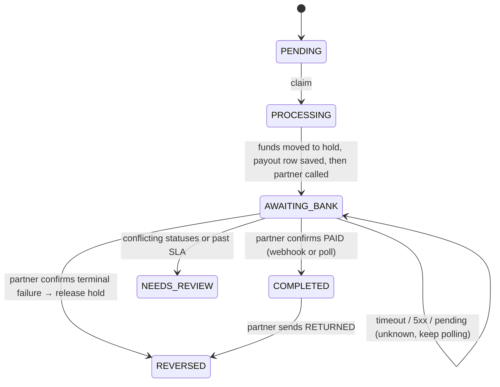

# Partner (bank / payout) integration

How TMS talks to external money partners, and how to add one.

**Status:** the inbound deposit webhook is implemented. The outbound side is a defined port
(`integration/bank/BankGateway`) with the contract below; a concrete adapter and the payout states are on the
[roadmap](ROADMAP.md). This document is the design those pieces follow.

## Directions

| Direction | Push | Pull |
|---|---|---|
| Partner → TMS | Deposit webhook ✅ (`POST /api/v1/webhooks/bank/deposits`) · payout status webhook (planned) | — |
| TMS → partner | `initiatePayout` (planned) | `fetchPayoutStatus`, `fetchDeposits` for reconciliation (planned) |

## The port

```kotlin
interface BankGateway {
    fun initiatePayout(request: PayoutRequest): BankResponse      // request carries our transactionId as the reference
    fun fetchPayoutStatus(bankReference: String): BankResponse
    fun fetchDeposits(since: Instant): List<BankDeposit>
}
```
One adapter per partner (`HsbcGateway`, `RazorpayXGateway`, `MockBankGateway` …) implements it.
Business code never sees HTTP, auth or partner-specific status codes.

## What we require from a partner

| Guarantee | Why we need it | If the partner can't give it |
|---|---|---|
| Payout is idempotent on **our** reference (transaction id) | A retry after a timeout must never pay twice | Never resubmit after a timeout; only poll status |
| Status lookup by our reference, with a definite "not found" | Resolves timeouts | Treat "not found" as unknown until a finality window passes, then escalate |
| Signed webhooks (HMAC), at-least-once, with an event id and timestamp | Trust, dedupe and order events | Rely on polling |
| Terminal states are final; reversals arrive as a separate RETURNED event | A paid payout can't silently turn into failed | Any change after a terminal state → manual review |
| Daily settlement / statement file | Reconcile our ledger against theirs | Reconcile manually |

## Payout lifecycle (planned states)



### Rules
1. **Hold before calling.** In one DB transaction: move the amount from the user's withdrawable balance to a
   `held` bucket, write ledger rows, set `AWAITING_BANK`, write an outbox event. Commit. **Then** call the partner.
   An HTTP call never runs inside a DB transaction.
2. **Map transport errors carefully.**

   | Partner response | Meaning | Action |
   |---|---|---|
   | 2xx `SUCCESS` | Paid | Settle hold → `COMPLETED` |
   | 2xx `PENDING` | Accepted, not final | Stay `AWAITING_BANK`, wait for webhook / poll |
   | 4xx validation error | Definitely not paid | Release hold → `REVERSED`, refund visible to user |
   | 5xx | Unknown | Retry with the **same** reference (idempotent partners only) or poll |
   | Timeout / connection reset | **Unknown**: money may have left | Never fail. Poll status by our reference |
3. **The customer never sees "failed" while the outcome is unknown.** `AWAITING_BANK` and `NEEDS_REVIEW`
   show as "Processing".
4. **Conflicting statuses.** The state machine rejects backward moves (stale or out-of-order webhooks are ignored).
   When two sources disagree on a terminal outcome: confirmed PAID wins; a failure after PAID counts only as an
   explicit RETURNED; anything else → `NEEDS_REVIEW` with an ops alert, resolved against the settlement file.
5. **Webhooks.** Verify HMAC and timestamp (5-minute replay window), store the raw event, dedupe on
   `(partner, event_id)`, return 200 quickly, process through the outbox like everything else.
6. **Polling.** The sweeper / a `BankReconciliationPoller` checks `AWAITING_BANK` rows by `next_check_at` with
   backoff (1m, 5m, 15m, 1h), covering partners without webhooks and missed webhooks.
7. **Resilience.** Per-partner timeouts, circuit breaker and bulkhead (resilience4j) so one slow partner can't
   exhaust threads; rate limits per partner contract.

## Adding a partner: checklist
1. Implement `BankGateway` in `integration/bank/<partner>/`; map partner codes to `BankStatus` per the table above.
2. Credentials (API keys, mTLS client cert, webhook HMAC secret) come from the secret manager, never from code
   or `values.yaml`: see [DEPLOYMENT.md](DEPLOYMENT.md).
3. Add a webhook controller for the partner's format that verifies the signature and dedupes on its event id.
4. Contract tests against the partner sandbox, plus `MockBankGateway` failure modes: timeout, 5xx, duplicate
   webhook, out-of-order webhook, conflicting status.
5. Add the partner's settlement file to daily reconciliation.
